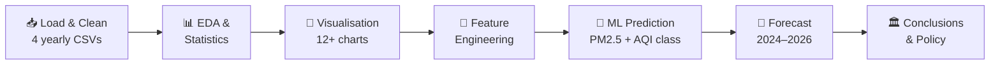

<div align="center">

# 🌫️ India Air Pollution Analysis & ML Prediction

### Exploring four years of air quality data (2020–2023) across Indian states and cities, and predicting PM2.5 with machine learning


**DSBDA Mini-Project** · Savitribai Phule Pune University (SPPU)

</div>

---

## 📌 Overview

Air pollution is one of India's most serious public health challenges. This project builds a complete data science pipeline on India's annual air quality data, from messy multi-year CSV files to cleaned data, exploratory analysis, engineered features, predictive models, and policy-oriented conclusions.

**What it does**

- 🧹 Merges and harmonises four years of inconsistent government datasets
- 📊 Produces **12+ visualisations** (heatmaps, distributions, trends, violin plots, rankings)
- 🏙️ Identifies the most and least polluted cities and tracks year-on-year change
- 🤖 Trains and compares **4 regression models** to predict PM2.5
- 🗂️ Classifies air quality into the 6 CPCB AQI categories
- 🔮 Projects PM2.5 levels for 2024–2026

---

## 📊 Dataset at a Glance

| Item | Detail |
|---|---|
| **Source** | India Annual Air Quality Data (CPCB), 2020, 2021, 2022, 2023 |
| **Files** | `dataset---2020.csv` … `dataset---2023.csv` |
| **Records** | 1,677 after cleaning |
| **Unique locations** | 828 cities / monitoring areas |
| **States / UTs** | 42 |
| **Pollutants** | SO₂, NO₂, PM10, PM2.5 (µg/m³) |

### Data challenges handled

| Year | Issue | Solution |
|---|---|---|
| 2020 | PM2.5 and PM10 columns filled with `-` (not collected) | Converted to NaN and imputed |
| 2021 | Minor dash values in PM columns | Numeric coercion |
| 2022 | No `Year` column | Year stamped during loading |
| 2023 | Hidden zero-width Unicode characters in headers; renamed state/city columns | Regex-based column normaliser |

**Imputation strategy:** City median → State median → Global median (cascade).

---

## 🔄 Project Workflow



| Phase | Description |
|---|---|
| 1. Data Loading & Cleaning | Multi-year merge, column harmonisation, missing value treatment |
| 2. EDA & Statistics | Descriptive stats, skewness/kurtosis, IQR outlier detection |
| 3. Visualisation | Heatmaps, trends, violin plots, city and state rankings |
| 4. Feature Engineering | AQI proxy, pollution index, PM ratio, YoY change |
| 5. ML Prediction | Linear, Ridge, Random Forest, Gradient Boosting |
| 6. Forecasting | 2024–2026 PM2.5 projection for selected cities |
| 7. Conclusions | Data-driven policy insights |

---

## 🔧 Engineered Features

| Feature | Description |
|---|---|
| `AQI_Proxy` | Maximum weighted sub-index across pollutants (simplified CPCB approach) |
| `AQI_Category` | CPCB 6-tier class: Good, Satisfactory, Moderate, Poor, Very Poor, Severe |
| `Pollution_Index` | Weighted sum: 0.30·PM2.5 + 0.25·PM10 + 0.25·NO₂ + 0.20·SO₂ |
| `PM_Ratio` | PM2.5 / PM10, the fraction of fine particles |
| `AQI_YoY` | Year-on-year change in AQI proxy per city |

---

## 🔍 Key Findings from the Analysis

### Descriptive statistics

| Pollutant | Mean | Median | Max | Skewness |
|---|---|---|---|---|
| SO₂ | 9.49 | 8.00 | 59 | 1.98 |
| NO₂ | 34.87 | 25.00 | 232 | 1.90 |
| PM10 | 89.85 | 84.00 | 319 | 1.29 |
| PM2.5 | 42.29 | 42.00 | 147 | 1.15 |

- **All pollutants are right-skewed.** A small number of heavily polluted locations pull the mean above the median.
- **Outliers (IQR method):** SO₂ 57, NO₂ 100, PM10 67, PM2.5 93.
- **Geography matters.** North Indian cities (Delhi belt, Uttar Pradesh, Bihar) dominate the most-polluted rankings, while southern, coastal and north-eastern locations are generally cleaner.

### City change, 2021 → 2023

| 🟢 Most improved | Δ total pollutants | 🔴 Most deteriorated | Δ total pollutants |
|---|---|---|---|
| Panipat | −102 | Nalbari | +62 |
| Vatva | −88 | Aurangabad | +61 |
| Nandesari | −78 | Gaya | +55 |
| Ballabgarh | −70 | Muzaffarpur | +55 |
| Lucknow | −65 | Patna | +43 |

---

## 🤖 Machine Learning Results

**Task:** Predict PM2.5 (µg/m³)
**Features:** `Year`, `SO2`, `NO2`, `PM10`, `City_Code`, `State_Code`
**Split:** 80/20 train-test, plus 5-fold cross-validation

| Model | Train R² | Test R² | MAE | RMSE | CV R² |
|---|---|---|---|---|---|
| Linear Regression | 0.634 | 0.693 | 7.06 | 10.16 | 0.625 |
| Ridge Regression | 0.634 | 0.693 | 7.06 | 10.16 | 0.626 |
| Random Forest | 0.941 | 0.812 | 4.19 | 7.96 | 0.764 |
| **Gradient Boosting** 🏆 | 0.980 | **0.844** | **4.16** | **7.24** | **0.779** |

**Best model:** Gradient Boosting, with a test R² of 0.844 and a mean absolute error of about 4.2 µg/m³.

### AQI category classifier (Random Forest)

| Metric | Score |
|---|---|
| Accuracy | **92%** |
| Macro F1 | 0.88 |
| Weighted F1 | 0.92 |

---

## 🔮 Forecast (2024–2026)

The Gradient Boosting model is used to project PM2.5 for the 10 most polluted and 5 cleanest locations. Even the worst-affected locations remain far above the WHO annual guideline of 15 µg/m³ in the projection.

> ⚠️ See [Limitations](#️-limitations--future-work) for important caveats about how this forecast is built.

---

## 🏛️ Policy Recommendations

| Priority | Action | Expected impact |
|---|---|---|
| **Immediate** | Real-time PM2.5 monitoring in all cities above 50K population | Eliminates data gaps |
| **Short-term** | Strengthen crop-burning controls in Punjab and Haryana | Lower winter PM2.5 |
| **Medium-term** | Accelerate EV adoption in the most polluted cities | Lower NO₂ |
| **Long-term** | Industrial zoning reform in Indo-Gangetic cities | Structural decline in pollution |

---

## 📁 Project Structure

> Adjust to match your repository.

```
india-air-pollution/
├── data/
│   ├── dataset---2020.csv
│   ├── dataset---2021.csv
│   ├── dataset---2022.csv
│   └── dataset---2023.csv
├── notebook.ipynb          # Full analysis and ML pipeline
├── requirements.txt
└── README.md
```

---

## ⚙️ Getting Started

### 1. Clone the repository

```bash
git clone https://github.com/<your-username>/<your-repo>.git
cd <your-repo>
```

### 2. Install dependencies

```bash
pip install pandas numpy matplotlib seaborn scipy scikit-learn jupyter
```

### 3. Run the notebook

```bash
jupyter notebook notebook.ipynb
```

Make sure the four CSV files are in the paths expected by the loading cell (`dataset---2020.csv` … `dataset---2023.csv`).

---

## 🧰 Tech Stack

| Category | Tools |
|---|---|
| Language | Python |
| Data handling | Pandas, NumPy |
| Visualisation | Matplotlib, Seaborn |
| Statistics | SciPy |
| Machine learning | scikit-learn (Linear/Ridge Regression, Random Forest, Gradient Boosting) |
| Environment | Jupyter Notebook |

---

## 📸 Screenshots

> Add your best charts here (state heatmap, model performance, forecast).

<!--


-->

---

## ⚠️ Limitations & Future Work

Being upfront about limitations makes the project stronger:

- **Heavy imputation.** PM2.5 and PM10 were not reported in 2020, and about 60% of PM2.5 values overall were filled using city, state and global medians. Imputed values can weaken real signal and make results look cleaner than the raw data supports.
- **Flat forecast.** Future predictions hold SO₂, NO₂ and PM10 fixed at their last known values, and tree-based models cannot extrapolate beyond the training range of `Year` (2020–2023). The 2024–2026 outputs are therefore constant per city and should be read as a baseline scenario, not a true trend forecast.
- **Classifier leakage.** AQI category is derived directly from the same pollutants used as input features, so the 92% accuracy partly reflects that relationship rather than independent predictive skill.
- **Granularity.** Many "cities" are actually individual monitoring areas, which is why the dataset contains 828 unique locations.
- **Random split.** A random train-test split can place the same city in both sets. A split by city or by year would give a stricter test.

**Ideas for improvement**

- Time-series models (ARIMA, Prophet, LSTM) for genuine forecasting
- Monthly or seasonal data to capture crop-burning and monsoon effects
- Weather features (temperature, humidity, wind)
- Interactive dashboard with Streamlit or Plotly Dash
- Choropleth maps of state-level pollution

---

## 📚 What I Learned

- Cleaning and merging inconsistent real-world datasets
- Choosing and justifying an imputation strategy
- Detecting outliers and interpreting skewed distributions
- Engineering domain-specific features (AQI proxy, pollution index)
- Comparing models with cross-validation and residual diagnostics
- Turning analysis into actionable policy insight

---

## 👤 Author

**Yash Nimbalkar**
Computer Engineering student, Savitribai Phule Pune University

---

<div align="center">

⭐ If you found this project useful, consider giving it a star!

</div>
